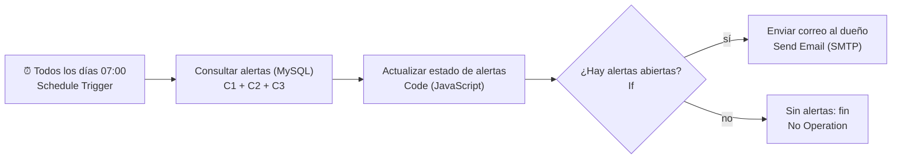

# 04 – Automatización con n8n: alerta diaria de inventario

Flujo: **«Las 3 Delicias – Alerta diaria de inventario (v2)»** (`automatizacion/…_n8n_flujo_alerta_inventario.json`). Zona horaria del flujo: `America/Santiago`.

## 1. Qué automatiza y por qué

Antes, el abastecimiento partía cuando alguien veía que faltaba algo. En el BPMN TO-BE (carril **Sistema (app web + n8n)**) parte con un evento temporizado diario a las 07:00. Cada mañana el propietario recibe un correo con lo que debe comprar, reponer en vitrina o usar antes de que venza. Se reemplaza la revisión visual por una comparación sistemática entre el stock calculado y los mínimos.

## 2. Arquitectura

El flujo tiene 6 nodos en 4 etapas (disparo → consulta → estado → decisión y envío).

| # | Nodo n8n (tipo) | Elemento BPMN TO-BE | Qué hace |
|---|---|---|---|
| 1 | **Todos los días 07:00** (`scheduleTrigger`, cron `0 7 * * *`) | Evento de inicio temporizado «Todos los días 07:00» | Inicia el flujo cada mañana |
| 2 | **Consultar alertas (MySQL)** (`mySql`, `executeQuery`, `alwaysOutputData`) | Tarea «Consultar stock, vitrina y vencimientos (C1 a C3)» | Ejecuta la consulta unificada. Devuelve una fila por alerta con `tipo`, `item`, `detalle`. Con `alwaysOutputData` el flujo sigue aunque no haya filas, para poder cerrar alertas |
| 3 | **Actualizar estado de alertas** (`code`, JavaScript) | Tarea «Actualizar estado de las alertas (abrir, mantener o cerrar)» | Clasifica cada alerta y arma asunto y cuerpo HTML |
| 4 | **¿Hay alertas abiertas?** (`if`, `total_abiertas > 0`) | Compuerta «¿Hay alertas abiertas?» | Rama verdadera → correo. Rama falsa → fin |
| 5 | **Enviar correo al dueño** (`emailSend`, HTML) | Tarea «Enviar correo con alertas al propietario» | Envía `asunto` y `html` al propietario |
| 6 | **Sin alertas: fin** (`noOp`) | Evento fin «Sin alertas abiertas» | Cierra la rama sin enviar nada |

## 3. Paso 2: consulta SQL (C1, C2, C3)

Reglas completas en [`03-sql-consultas.md`](03-sql-consultas.md). Resumen:

- **C1 – `Comprar`:** insumos con stock (suma de lotes) menor que `GREATEST(stock_minimo_semanal, consumo últimos 7 días)`.
- **C2 – `Vitrina`:** productos con stock en tienda menor que `stock_minimo_tienda`. Sugiere reponer desde bodega o producir.
- **C3 – `Vence`:** lotes de insumos que vencen en 5 días o menos, incluidos los ya vencidos.

Variantes de la consulta (misma lógica):

| Variante | Fecha | Salida | Dónde se usa |
|---|---|---|---|
| `…_consulta_alertas_workbench.sql` | fija 16-11-2026 | tabla | Revisión manual / reproducción del seed |
| `…_consulta_alertas_json.sql` | fija 16-11-2026 | una celda JSON (`json_n8n`) | Obtener el JSON equivalente a los datos fijados |
| Consulta del nodo MySQL | `CURDATE()` | tabla | Ejecución diaria real |

## 4. Paso 3: lógica de estado (JavaScript)

Código: `automatizacion/…_n8n_codigo_nodo_estado_alertas.js` (idéntico al del nodo del flujo).

- **Clave de alerta:** `tipo | item | fecha de vencimiento` (esta última solo en `Vence`). Si el mismo insumo vuelve a vencer en otra fecha, es otra alerta.
- **Memoria:** el estado se guarda entre ejecuciones con `$getWorkflowStaticData('global')`.
- **Clasificación frente a la ejecución anterior:**

| Estado | Condición | Efecto |
|---|---|---|
| `nueva` | La clave no estaba antes | Se abre con `desde = hoy` |
| `pendiente` | La clave ya estaba abierta | Se mantiene y calcula su antigüedad (`hoy − desde`, en días) |
| `cerrada` | Estaba antes y hoy no aparece (stock repuesto, vitrina repuesta o lote ya no vence) | Se informa como cerrada con los días que estuvo abierta |

- **Salida (un ítem):**
  - `asunto`: `Inventario <fecha>: N alertas abiertas (n nuevas, p pendientes, c cerradas)`.
  - `html`: secciones «🛒 Insumos para comprar», «🧁 Falta en vitrina», «⏰ Vence en 5 días o menos» y «✅ Cerradas desde ayer». Cada alerta abierta lleva «(nueva)» o «(pendiente hace N días)».
  - Contadores `total_abiertas`, `nuevas`, `pendientes`, `cerradas`.

## 5. Paso 4: compuerta y correo

- La compuerta `If` evalúa `total_abiertas > 0`, es decir `nuevas + pendientes`. Las cerradas no cuentan.
- Si hay alertas abiertas se envía el correo al propietario. Si no, el flujo termina en `noOp` sin enviar nada.

## 6. Trazabilidad con el resto del repositorio

| Elemento | Respaldo |
|---|---|
| Tarea y evento BPMN | [`/assets/bpmn.mdd`](/assets/bpmn.md), carril «Sistema (app web + n8n)» |
| Reglas C1–C3 e interpretación | [`03-sql-consultas.md`](03-sql-consultas.md) |
| Requerimientos cubiertos | RF07–RF09 (mínimos, identificar reposición, alertas) y RF14–RF17 (ubicación, vencimiento, receta, reposición). 

## 7. Cómo reproducirlo

1. **Importar:** `Workflows → Import from file →` el `.json`.
2. **Credenciales** (el JSON exportado las trae vacías):
   - `MySQL las3delicias`: host, puerto, base `las3delicias`, usuario y contraseña.
   - `SMTP alertas`: servidor, puerto, usuario y contraseña.
3. **Correo:** reemplazar `correo-del-propietario@ejemplo.cl` (destino) y `alertas@las3delicias.cl` (remitente).
4. **Prueba sin base de datos:** el nodo MySQL viene con **datos fijados** (13 alertas del 16-11-2026). Pulse *Execute workflow*: el nodo de estado clasifica las 13 alertas como `nueva` y la compuerta las envía al correo.
5. **Prueba con base:** cargue `db/schema.sql` y `db/seed.sql`, quite el pin data del nodo MySQL y ejecute. La consulta usa `CURDATE()`, así que con el seed fijo en 16-11-2026 el resultado dependerá de la fecha en que se ejecute.
6. **Producción:** active el flujo (*Active*) para que corra a las 07:00.

## 8. Evidencia de ejecución

La prueba documentada en el informe (Figuras 3 y 4) se hizo con datos fijados: el nodo de estado clasificó 13 alertas como nuevas y la compuerta las dirigió al envío. El envío estaba desactivado, así que **no se envió ningún correo**. n8n no se conectó a MySQL en esa prueba.

## 9. Limitaciones

- **Estado en memoria del flujo.** No hay tabla de alertas en el ER. Si se reimporta o reinicia el flujo, se pierde la antigüedad de las alertas.
- **Cierres sin correo.** Si todas las alertas se cierran el mismo día, `total_abiertas = 0` y no se envía el aviso de cierre.
- **Sin vencimientos de productos terminados.** Se gestionan en la tarea BPMN «Revisar vencimientos y registrar merma».
- **Fecha de referencia.** La consulta del nodo usa `CURDATE()`; las variantes `.sql` usan una fecha fija.
- **Envío de correo sin probar.** El envío real no se probó (nodo desactivado en la prueba documentada). 
